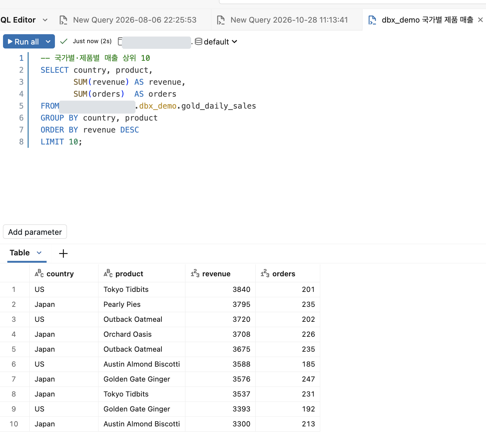

# SQL 에디터와 쿼리 기록

> 기준일: 2026-10-28 · 근거: 공식 문서 · 수준: 200

SQL 에디터(SQL Editor)는 Databricks SQL에서 쿼리를 작성하고 실행하는 기본 화면입니다. 쿼리 기록(Query history)은 실행된 쿼리의 상태, 실행자, 소요 시간을 한곳에서 보여주는 기록입니다. 이 페이지는 두 기능의 사용법과 권한 규칙, 그리고 시스템 테이블(`system.query.history`)로 기록을 분석하는 방법을 다룹니다.

## 왜 필요한가

분석 쿼리는 여러 사람이 같은 웨어하우스에서 실행합니다. 쿼리가 느릴 때 "누가, 언제, 어떤 문장을 실행했는지"를 알지 못하면 원인을 좁히기 어렵습니다. 에디터가 쿼리 작성과 실행을 한 화면에 모으고, 쿼리 기록이 실행 이력을 남기므로 다음 문제를 해결합니다.

| 이전 방식의 한계 | 에디터·쿼리 기록의 접근 |
|---|---|
| 쿼리 파일이 개인 PC에 흩어짐 | 에디터에서 쿼리를 저장하고 공유하며 함께 편집 |
| 실행 이력이 웨어하우스 로그에만 있음 | 쿼리 기록 UI와 `system.query.history` 테이블로 조회 |
| 실행 중인 쿼리를 멈추기 어려움 | 쿼리 기록의 취소(Cancel) 버튼으로 실행 중인 쿼리 중단 |

## 어떻게 동작하는가

### SQL 에디터

공식 문서 기준 SQL 에디터의 주요 기능은 다음과 같습니다.

| 영역 | 기능 (문서 표기 기준) |
|---|---|
| 작성 | SQL 웨어하우스에 연결하고, 카탈로그와 스키마를 탐색하며, 자동 완성(autocomplete)과 Genie Code로 SQL을 작성 |
| 실행·공유 | 단일 문장 또는 여러 문장을 실행하고, 협업자와 공유하며, 실시간으로 함께 편집 |
| 결과 | 결과를 시각화하고, 필터링하고, 다운로드하고, 분석 |
| 파라미터 | 명명된 파라미터(named parameter)를 추가하고 파라미터 위젯을 구성 |
| 서식 | SQL 자동 서식(auto-formatting) 옵션을 설정 |
| 작업 공간 도구 | 워크스페이스 파일 브라우저, Genie Code 사이드 패널, 명령 팔레트, 코드 주석, 버전 기록 |

> **참고** Genie Code의 사용법은 [Genie Code 가이드](../11-developer-tools/genie-code/README.md)에서 다룹니다. 이 장은 에디터 안에서 Genie Code를 호출하는 지점만 다룹니다.

에디터는 마지막으로 열었던 쿼리로 열립니다. 열린 쿼리가 없으면 랜딩 페이지가 열립니다.

### 쿼리 기록

쿼리 기록은 실행 이력을 보여줍니다. 공식 문서는 서버리스 컴퓨트를 쓰는 워크스페이스에서는 노트북과 잡에서 실행된 SQL·Python 쿼리도 포함된다고 설명합니다.

**상세 패널에 표시되는 항목**

| 항목 | 설명 |
|---|---|
| 쿼리 상태 | 아래 상태 표 참조 |
| 사용자와 컴퓨트 | 실행자와 실행된 컴퓨트 정보 |
| ID | 쿼리의 UUID |
| 쿼리 문장 | 전체 SQL 텍스트 |
| 쿼리 지표 | 실행 지표 |
| 쿼리 프로필 미리보기 | DAG 미리보기. 전체는 3번 페이지 |
| 가장 긴 연산자 | 실행 시간이 긴 연산자 목록 |
| 경과 시간, 소스, 집계 태스크 시간, 입출력(IO) | 실행 요약 |

**필터**: 사용자, 날짜 범위, 컴퓨트, 실행 시간, 쿼리 상태, 문장 유형, 문장 ID, 쿼리 태그.

**상태 라벨**

| 상태 | 의미 (문서 표기) |
|---|---|
| Queued | 대기 중 |
| Running | 실행 중 |
| Finished | 완료 |
| Failed | 실패 |
| Cancelled | 취소됨. 문서 내 종료 절은 "Canceled"로 표기되어 철자가 혼용됨 |

**접근 권한**

- 쿼리 소유자는 자신의 실행 기록을 볼 수 있습니다.
- 다른 사용자는 해당 SQL 웨어하우스에 대해 최소 `CAN VIEW` 권한이 있으면 실행 기록을 볼 수 있습니다.
- "Run as Owner" 권한으로 공유된 쿼리는 공유한 사람이 아니라 실제로 실행한 사용자의 기록에 나타납니다.

### 시스템 테이블로 분석하기

`system.query.history` 시스템 테이블에는 계정 전체의 쿼리 이력이 표 형태로 쌓입니다. 공식 문서는 기본적으로 관리자만 시스템 테이블에 접근할 수 있다고 설명합니다. 활성화와 쿼리 방법은 시스템 테이블 레퍼런스를 따릅니다.

```sql
-- 시스템 테이블의 스키마(컬럼명과 타입)를 먼저 확인한다
DESCRIBE TABLE system.query.history;
```

> **주의** 이 페이지는 시스템 테이블의 컬럼명을 예시로 쓰지 않습니다. 컬럼명은 버전에 따라 달라질 수 있으므로 위 `DESCRIBE`로 확인한 뒤 쿼리를 작성하십시오.

## 어떻게 쓰는가



*그림 — SQL 에디터에서 쿼리를 실행하고 결과 표를 확인하는 화면. 예제 데이터이며 이름·카탈로그 이름 같은 식별 정보는 가렸습니다. 화면은 2026년 10월 기준입니다.*

### 쿼리를 작성하고 실행하는 절차

1. SQL Editor를 엽니다.
2. 상단에서 SQL 웨어하우스를 선택합니다.
3. 카탈로그 탐색기에서 대상 테이블을 찾아 이름을 확인합니다.
4. 쿼리를 작성합니다. 여러 문장은 세미콜론으로 구분하고, 필요하면 파라미터를 넣습니다.
5. 실행하고 결과를 확인합니다.

파라미터를 쓰는 예시는 다음과 같습니다. 파라미터 마커의 문법은 4번 페이지에서 설명합니다.

```sql
-- 에디터의 명명된 파라미터는 :name 형태로 쓴다
-- 파라미터 위젯 값은 에디터 UI에서 지정한다
SELECT order_id, amount
FROM main.sales.orders
WHERE region = :region
  AND order_date >= :start_date;
```

### 실행 중인 쿼리 취소하기

쿼리 기록에서 실행 중인 쿼리를 선택하면 **Cancel** 버튼이 나타납니다. 공식 문서는 Lakeflow 파이프라인 컴퓨트에서 실행된 문장은 파이프라인 UI에서만 취소할 수 있다고 명시합니다.

### 쿼리 결과 캐시 우회

공식 문서의 쿼리 프로필 페이지는 캐시에서 실행된 쿼리에 대해 "Query profile is not available" 메시지가 나올 수 있다고 설명하며, 이때 `LIMIT`을 바꾸거나 제거하라고 안내합니다. 결과 캐시 설정 파라미터는 레퍼런스의 `USE_CACHED_RESULT`에 정의되어 있습니다.

## 트레이드오프

| 선택지 | 장점 | 단점 |
|---|---|---|
| 에디터에서 직접 작성 | 빠른 탐색과 실행 | 버전 관리가 약함. 버전 기록에 의존 |
| 노트북에서 SQL 셀 실행 | 파이썬과 함께 작업 | 쿼리 기록의 노트북 실행 항목 해석이 필요 |
| 대시보드·알림에 쿼리 연결 | 반복 실행과 공유 자동화 | 쿼리 변경이 소비자에 즉시 영향 |

## 주의사항

- **권한과 실행 주체를 구분합니다.** 쿼리 기록은 웨어하우스 권한에 따라 보이는 범위가 달라집니다. 다른 사람의 쿼리가 보이지 않을 때는 웨어하우스 권한부터 확인합니다.
- **민감한 값을 쿼리 문장에 직접 넣지 않습니다.** 쿼리 기록에는 전체 문장이 남으므로, 토큰이나 개인정보 값을 리터럴로 쓰면 기록에 남습니다. 파라미터로 분리합니다.
- **쿼리 기록의 보존 기간은 문서에 명시되어 있지 않습니다.** 장기 감사가 필요하면 시스템 테이블을 주기적으로 별도 테이블에 복사하는 방식을 설계합니다.
- **`system.query.history` 접근은 관리자 권한이 기본입니다.** 일반 사용자에게 접근을 열기 전 거버넌스 정책을 확인합니다(12장에서 다룹니다).

## 참고 문서

- [Data warehousing on Databricks](https://docs.databricks.com/aws/en/sql/)
- [SQL 에디터](https://docs.databricks.com/aws/en/sql/user/sql-editor/)
- [쿼리 기록](https://docs.databricks.com/aws/en/sql/user/queries/query-history)
- [쿼리 프로필](https://docs.databricks.com/aws/en/sql/user/queries/query-profile)
