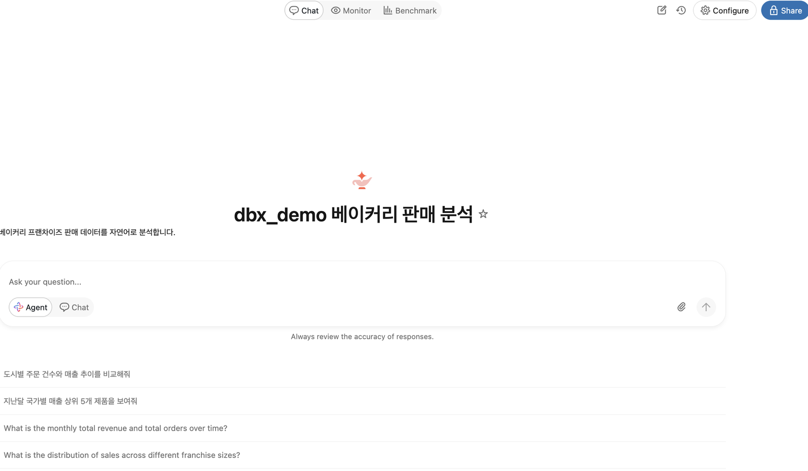

# Genie Agents 만들기

> 기준일: 2026-10-28 · 근거: 공식 문서 · 수준: 200

## 한눈에 보기

**Genie Agents** 는 데이터 분석가가 설정하는 도메인별 자연어 대화 인터페이스입니다. 사용자가 질문하면 Genie가 관련 데이터 소스를 찾고, 읽기 전용 SQL을 만들어 SQL 웨어하우스에서 실행하고, 쿼리와 결과 표, 시각화를 돌려줍니다. 문서는 Genie Agents가 이전에 **Genie Spaces** 라고 불렸다고 명시합니다.

이 페이지는 Genie Agent를 만들고, 데이터 소스와 기본 설정을 채우고, 권한을 정하고, 공유하는 절차를 다룹니다. 답의 정확도를 높이는 설계(인스트럭션, 예제 SQL, 지식 저장소, 벤치마크)는 [6페이지](genie-agents-quality.md)에서 다룹니다.

## 1. 왜 필요한가

### 이전 방식의 한계

- 현업 사용자는 새 질문마다 데이터 팀에 요청을 넣어야 합니다. 질문이 쌓이면 응답이 늦어집니다.
- 대시보드는 정해진 질문에만 답합니다. 열린 탐색이나 후속 질문에는 맞지 않습니다.
- 사내 용어(예: "파이프라인" 정의, 회계 연도)가 SQL 쪽에만 있으면 현업 질문과 어긋납니다.

Genie Agent는 데이터 분석가가 용어와 예제를 한 번 설정해 두면, 현업 사용자가 자연어로 같은 데이터를 질문할 수 있게 합니다. 용어와 계산식은 인스트럭션, 예제 SQL, 지식 저장소에 담깁니다.

## 2. 어떻게 동작하는가

### 질문 처리 흐름

공식 개념 문서가 설명하는 흐름은 다음과 같습니다.

1. Genie가 질문을 해석하고 관련 데이터 소스를 찾습니다.
2. 맥락(context)을 골라 읽기 전용 SQL을 생성합니다.
3. 에이전트의 SQL 웨어하우스에서 쿼리를 실행하고, 쿼리와 결과 표를 돌려줍니다.
4. 답할 수 없으면 후속 질문을 던질 수 있습니다.

답을 만들 때 쓰는 맥락은 다음과 같습니다.

| 맥락 | 설명 |
|---|---|
| UC 테이블 메타데이터 | 이름, 설명, 기본 키와 외래 키 관계 |
| 열 이름과 설명 | UC의 열 주석 포함 |
| 지식 저장소(Knowledge store) | 에이전트 전용 메타데이터. UC 메타데이터를 바꾸지 않음 |
| 예제 SQL(Example SQL queries) | 질문과 관련 있는 예제를 Genie가 골라 참고 |
| SQL 함수 | 에이전트에 추가한 SQL 함수 |
| 인스트럭션(Instructions) | 일반 지침을 평문으로 기술 |
| 대화 이력 | 토큰 한도 때문에 가장 오래된 부분이 잘릴 수 있음 |

지식 저장소는 개념 문서에서 에이전트 전용 메타데이터로 설명됩니다. 자세한 설계는 6페이지에서 다룹니다.

### 두 가지 실행 모드

| 모드 | 용도 | 상태 |
|---|---|---|
| Chat mode(기본) | 정형 데이터의 단순 질문. 비정형 파일, MCP 커넥터, 다단계 분석은 불가 | 문서에 명시 없음 |
| Agent mode | 여러 쿼리가 필요한 복잡한 질문, 구조화된 보고서, 볼륨 파일, 외부 도구 | 문서에 상태 라벨 없음. 2026-10-15 릴리즈 노트는 모델 업그레이드만 기록 |

문서는 Agent mode가 이전에 "Research Agent"로 불렸다고 명시합니다. Flash(Beta)는 단순한 질문에 속도를 우선하는 Agent mode 옵션이며, 워크스페이스 관리자가 "Genie Agents Flash Mode"를 켜야 합니다. Inspect(Public Preview)는 생성된 SQL을 검토해 필터, 날짜 범위, 조인을 점검하고 더 정확한 쿼리를 반환할 수 있습니다.

> **주의** 비정형 파일이나 MCP 커넥터가 필요하면 Chat mode가 아니라 Agent mode여야 합니다. 볼륨 파일 조회는 Beta입니다.

## 3. 어떻게 쓰는가

*그림 — Genie Agent 첫 화면 — 설명, 질문 입력창, 추천 질문. 예제 데이터이며 이름·카탈로그 이름 같은 식별 정보는 가렸습니다. 화면은 2026년 10월 기준입니다.*

### 사전 조건

| 항목 | 요구 사항 |
|---|---|
| SQL 웨어하우스 | pro 또는 serverless SQL 웨어하우스. 최소 CAN USE 권한. 문서는 성능을 위해 serverless를 권장 |
| 데이터 | UC에 등록되고 `SELECT` 권한이 부여된 데이터 |
| 엔타이틀먼트 | Databricks SQL 워크스페이스 엔타이틀먼트. 계정 관리자가 파트너 기반 AI 기능을 켜야 함 |
| 에이전트 권한 | 최소 CAN EDIT. 생성자는 자동으로 CAN MANAGE |

> **참고** 데이터 권한과 웨어하우스 권한은 작성자에게 필요한 조건입니다. 최종 사용자는 웨어하우스 권한이 필요 없고, 데이터 접근은 사용자 자신의 UC 권한으로 검사된다고 문서가 설명합니다.

### 만들기

1. 사이드바에서 **Genie Agents** 를 누릅니다.
2. 오른쪽 위 **New** 를 누릅니다.
3. 데이터 소스를 고르고 **Create** 를 누릅니다.

Genie Code가 자동으로 실행되어 테이블 설명과 예제 쿼리를 제안합니다. 제안은 하나씩 수락하거나 거절할 수 있습니다. 공식 문서는 공유하기 전에 예제 SQL, 인스트럭션, 지식 저장소를 추가하라고 권장합니다. Genie Code 자체의 사용법은 [11장 Genie Code](../11-developer-tools/genie-code/README.md)에서 다룹니다.

### 데이터 소스 추가와 제거

- **Configure > Data** 로 이동해 **Add** 로 테이블을 추가합니다. 휴지통 아이콘으로 제거합니다.
- 객체 이름을 누르면 **Overview**(열과 타입)와 **Sample data** 탭을 볼 수 있습니다.
- 에이전트는 **자신에게 붙은 데이터 소스만** 조회합니다. 2026-09-17 릴리즈 노트는 이 동작을 명시합니다.
- 2026-08-27 릴리즈 노트에 따르면 UC의 스칼라 함수와 테이블 반환 함수를 에이전트 도구로 붙일 수 있습니다.
- 2026-08-27 릴리즈 노트에 따르면 UC 테이블을 Genie에서 직접 열 수 있습니다. 채팅, Discover, Ask Genie 진입점을 제공합니다.

데이터 소스 한도는 에이전트당 **테이블, 뷰, 메트릭 뷰 합쳐서 50개** 입니다. 2026-09-10 릴리즈 노트에 따르면 이전 한도는 30개였습니다.

### 인스트럭션과 예제 질문

- 인스트럭션 패널과 **SQL Queries** 맥락에서 인스트럭션과 예제 SQL을 관리합니다.
- 예제 질문(Common questions)은 **Configure > Settings** 에서 설정합니다. 입력한 질문이 랜딩 페이지에 먼저 나오고, 남은 자리는 Genie가 만든 질문으로 채웁니다.

인스트럭션과 예제 SQL의 설계 원칙은 6페이지에서 다룹니다.

### 설정 항목

**Configure > Settings** 에서 다음 항목을 정합니다.

| 항목 | 설명 |
|---|---|
| Title | 에이전트 이름 |
| Default warehouse | 기본 SQL 웨어하우스 |
| Tags | 분류용 태그 |
| Thumbnail | 대표 이미지 |
| Description | 설명. Markdown 지원 |
| Common questions | 랜딩 페이지의 예제 질문 |

### 권한 수준

Genie Agent에는 네 가지 권한이 있습니다.

| 권한 | 할 수 있는 일 |
|---|---|
| CAN MANAGE | 설정, 공유, 삭제 등 모든 관리. 생성자가 자동으로 받음 |
| CAN EDIT | 데이터 소스, 인스트럭션, 예제 SQL 편집 |
| CAN RUN | 에이전트와 대화 |
| CAN VIEW | 보기와 대화 |

대화하는 사용자는 CAN VIEW 또는 CAN RUN 권한과 함께 **Consumer 엔타이틀먼트** 또는 **Databricks SQL 엔타이틀먼트** 가 필요합니다.

### 공유

1. 에이전트에서 **Share** 를 누릅니다.
2. 사용자나 그룹을 입력하고 **Add** 를 누릅니다.
3. 권한 수준을 고릅니다.

- **Copy link** 로 직접 링크를 복사할 수 있습니다.
- **All account users** 를 고르면 계정 전체에 공유합니다.
- 새 에이전트는 사용자 폴더에 저장되며, 폴더의 권한을 상속합니다.
- 대화(conversation)는 별도로 공유할 수 있습니다.
- 외부 공유는 OpenSharing을 씁니다.

Genie Agent를 웹사이트나 앱에 넣는 방식(iframe 임베딩)은 [4페이지](schedule-subscribe-embed.md)에서 다룹니다.

### 인증서(Certification) 표시

에이전트에는 **인증 상태** 를 붙일 수 있습니다. 문서는 `system.certification_status` 거버넌스 태그를 씁니다. 설정하려면 해당 태그에 대한 ASSIGN 권한이 필요합니다. 선택지는 **Certified**, **Deprecated**, **None** 이며, 케밥 메뉴의 **Assign certification** 에서 정합니다.

### 복제와 메트릭 뷰로 내보내기

- **Clone** 은 테이블, 설정, 인스트럭션, 예제 SQL, SQL 함수를 복사합니다. 대화 스레드와 모니터링 데이터는 복사하지 않습니다.
- **Export to metric view** 는 에이전트의 맥락에서 메트릭 뷰를 만듭니다. 정의와 거버넌스는 06장과 [7페이지](metric-views-in-ai-bi.md)를 참고하십시오.

### 한도

| 항목 | 한도 |
|---|---|
| 에이전트당 테이블·뷰·메트릭 뷰 | 50 |
| 에이전트당 대화 | 200,000 |
| 대화당 메시지 | 10,000 |

2026-09-10 릴리즈 노트에 따르면 대화 한도는 10,000에서 200,000으로 올라갔습니다.

## 4. 트레이드오프

- **데이터 소스를 적게 붙일수록 답이 정확해지기 쉽습니다.** 50개 한도가 있지만, 질문 범위가 좁으면 소스를 더 줄이는 편이 낫습니다. 문서는 에이전트가 붙은 소스만 조회한다고 설명합니다.
- **Chat mode는 정형 데이터의 단순 질문에 맞습니다.** 다단계 분석이나 비정형 파일은 Agent mode가 필요합니다. 두 모드의 비용 차이는 이 장에서 확인하지 않았습니다.
- **Genie 대신 대시보드를 쓰는 편이 나은 경우가 있습니다.** 같은 질문을 매일 반복한다면 대시보드가 결과를 더 안정적으로 보여줍니다.
- **Genie 결과는 비결정적입니다.** 같은 질문도 표현에 따라 다른 SQL이 나올 수 있으므로 정기 보고 수치의 근거로 쓰기에는 검토가 필요합니다.

### 언제 쓰지 않는가

- 법적 효력이 있는 확정 수치를 생성형 답으로 내보내야 하는 경우
- 데이터 소스가 UC 밖에 있어서 등록이 불가능한 경우(외부 도구 연결은 Beta)

## 5. 주의사항

- **공유 전에 설정을 채웁니다.** 공식 문서는 예제 SQL, 인스트럭션, 지식 저장소를 추가한 뒤 공유하라고 권장합니다.
- **웨어하우스 권한을 확인합니다.** 작성자에게 CAN USE가 없으면 만들 수 없고, pro나 serverless가 아니면 조건에 맞지 않습니다.
- **Databricks SQL 엔타이틀먼트를 확인합니다.** 엔타이틀먼트가 없는 사용자는 대화할 수 없습니다. Consumer access 사용자는 대화는 가능하지만 새 객체를 만들 수 없습니다.
- **계정 전체 공유는 신중하게 씁니다.** All account users는 계정의 모든 사용자에게 열립니다. 데이터 접근은 사용자별 UC 권한으로 검사된다고 문서가 설명하지만, 에이전트 설정이 어디까지 보이는지는 이 장에서 확인하지 않았습니다.
- **인증서 표시를 운영 절차에 넣습니다.** Certified, Deprecated, None 표시를 누가 관리하는지 정해 두십시오.
- **라벨을 확인합니다.** Genie Agents 전체에는 GA 또는 Public Preview 라벨이 붙어 있지 않습니다. Flash(Beta), Inspect(Public Preview), 외부 도구 연결(Beta)처럼 기능별로 라벨이 다릅니다.

## 참고 문서

- [Genie Agents 개요](https://docs.databricks.com/aws/en/genie-agents/)
- [Genie Agents 개념](https://docs.databricks.com/aws/en/genie-agents/concepts)
- [Genie Agent 만들기와 관리](https://docs.databricks.com/aws/en/genie-agents/set-up)
- [AI/BI 개요와 Genie 제품 구분](https://docs.databricks.com/aws/en/ai-bi/)
- [Consumer access](https://docs.databricks.com/aws/en/ai-bi/consumers/)
- [AI/BI 릴리즈 노트 (2026)](https://docs.databricks.com/aws/en/ai-bi/release-notes/2026)
