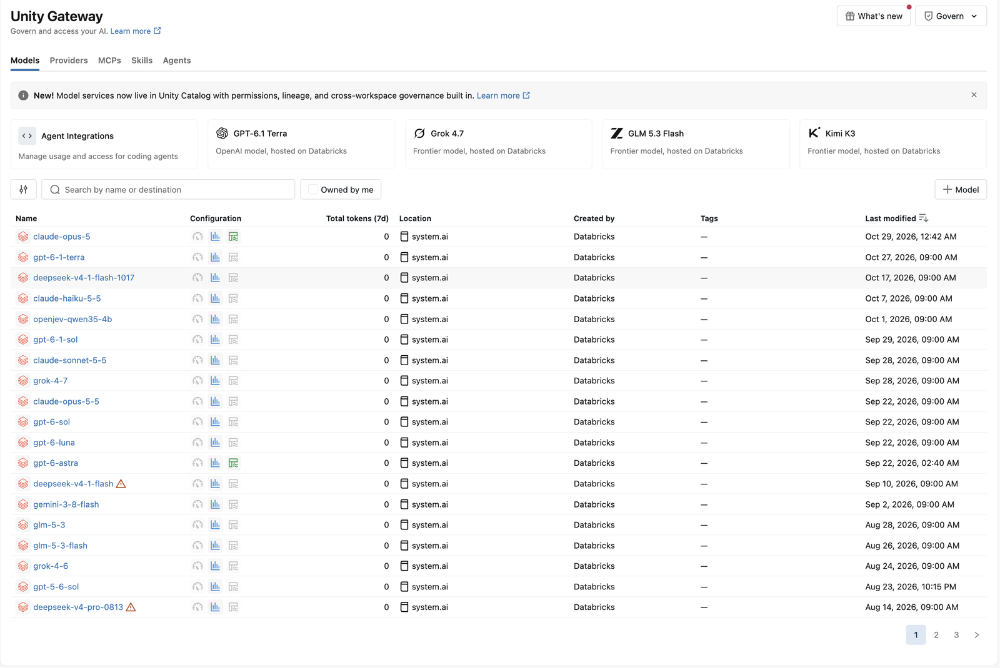

# Unity Gateway

> 기준일: 2026-10-28 · 근거: 공식 문서 · 수준: 300

Unity Gateway는 Unity Catalog 위에서 모델, 모델 제공자 서비스, MCP 서버, 에이전트 도구의 **런타임 호출** 을 관리하는 엔터프라이즈 AI 거버넌스 계층입니다. 접근 제어, 트래픽 한도, 가드레일(서비스 정책), 사용량 추적을 한 체계로 묶습니다. 문서는 Unity Gateway를 "엔터프라이즈 AI 거버넌스 솔루션"이라고 소개하며, 2026-08-04에 일반 공개(GA)되었다고 릴리즈 노트가 밝힙니다.

> **참고** 문서 안에는 두 체계가 공존합니다. 이 페이지의 주인공은 **Unity Gateway**(새 경험)입니다. 서빙 엔드포인트 설정 화면의 **AI Gateway(legacy)** 는 별도 기능이며, 아래 "레거시 AI Gateway" 절에서 따로 다룹니다. 랜딩 메뉴와 URL 경로에 남은 "AI Gateway"는 이 두 가지를 함께 가리키는 것으로 보이지만, 문서가 그렇게 명시하지는 않습니다.

## 왜 필요한가

| 운영 중 생기는 문제 | Unity Gateway의 대응 (문서 원문 기준) |
|---|---|
| 특정 사용자나 팀이 토큰과 요청을 과도하게 쓴다 | 서비스·사용자·사용자 그룹 단위 한도 (QPM, TPM) |
| 누가 어떤 모델과 도구를 호출했는지 알 수 없다 | `system.ai_gateway.usage` 시스템 테이블과 사용량 대시보드 |
| 민감 정보가 요청이나 응답에 섞인다 | `detect_sensitive_data` 정책으로 탐지하고 차단 또는 마스킹 |
| MCP 도구 호출이 탈옥이나 프롬프트 인젝션에 노출된다 | `block_jailbreak` 정책 (Beta) |
| 정책 시스템이 죽으면 어떻게 되는지 불분명하다 | 평가 실패는 DENY로 처리 (fail closed) |

## 구성 요소와 상태

*그림 — Unity Gateway 화면의 모델 목록. 예제 데이터이며 이름·카탈로그 이름 같은 식별 정보는 가렸습니다. 화면은 2026년 10월 기준입니다.*

릴리즈 노트 기준 상태 라벨과 기능 위치를 함께 정리합니다. 개요 페이지 본문에는 상태 라벨이 없으므로, 아래 상태는 모두 릴리즈 노트 항목의 날짜를 씁니다.

| 기능 | 문서 위치 | 상태 (릴리즈 노트) |
|---|---|---|
| Unity Gateway 전체 | 제품 | GA (2026-08-04) |
| 한도 (rate limit) | 트래픽 관리 > Apply rate limits | 표기 없음 |
| 사용량 추적 | 모니터링 > Monitor usage | 기본 켜짐 (2026-07-17) |
| 사용량 대시보드 v1.0 | 모니터링 | 표기 없음 (2026-10-27) |
| 세션 메타데이터·토큰 상세 | 모니터링 | Public Preview (2026-09-27) |
| 서비스 정책 (Service policies) | 가드레일 | Beta (2026-08-04 항목 "여전히 Beta") |
| 민감 데이터 탐지 | 가드레일 | Beta (2026-08-13) |
| MCP 도구 호출 탈옥 탐지 | 가드레일 | Beta (2026-10-21) |
| 파트너 가드레일 (외부 서비스 정책) | 가드레일 | Beta (2026-10-07) |

## 접근 제어

Unity Catalog 권한이 "누가 서비스를 호출할 수 있는가"를 정하고, 서비스 정책이 "호출 내용을 어떻게 처리하는가"를 정합니다. 문서의 대상 자산은 다음과 같습니다.

| 대상 | 설명 |
|---|---|
| 모델 서비스 (Model services) | 커스텀 모델 서비스 생성 가능 |
| 모델 제공자 서비스 (Model provider services) | 외부 모델 제공자 연결 |
| MCP 서비스 | MCP 도구 서버 |
| 에이전트 서비스 | 서비스 정책 대상이 아님 (문서 명시) |

## 트래픽 관리: 속도 제한 (Rate limits)

### 무엇을 제한하는가

| 서비스 종류 | 제한 단위 |
|---|---|
| 모델 서비스 | 분당 요청 수 (QPM) 과 분당 토큰 수 (TPM) |
| MCP 서비스 | QPM만. 토큰 기반 제한은 적용되지 않음 |

### 적용 범위

| 범위 | 의미 |
|---|---|
| Service | 서비스 전체 최대치. 사용자와 무관하게 모든 트래픽에 적용. 초과하면 모든 요청이 차단됨 |
| User (Default) | 모든 사용자에 대한 사용자별 기본 한도. 커스텀 한도가 있으면 그것이 우선 |
| Custom, individual | 특정 사용자 또는 서비스 프린시펄별 한도. 그룹 한도보다 우선 |
| Custom, user group | 그룹 구성원 전체가 공유하는 한도 |

### 설정 절차와 값의 한도

1. 모델 서비스 또는 MCP 서비스 구성을 엽니다.
2. **Rate limits** 를 선택합니다.
3. 서비스, 기본 사용자, 커스텀 사용자 또는 그룹 단위로 한도를 설정합니다.

문서는 REST API, Databricks SDK, CLI, Terraform으로도 설정할 수 있다고 설명하지만 코드 예제는 싣지 않았습니다. 이 장도 예제를 추정하지 않았습니다.

| 항목 | 값 (문서 원문) |
|---|---|
| 서비스당 한도 개수 | 최대 20개 |
| 서비스당 그룹 전용 한도 | 최대 5개 |
| 기본 설정 | 사용자 한도와 서비스 한도 모두 기본 설정 없음 |

### 우선순위와 초과 동작

- 요청 기반 한도와 토큰 기반 한도가 동시에 걸리면 더 엄격한 쪽이 적용됩니다.
- 사용자 전용 한도와 그룹 한도가 동시에 있으면 사용자 전용 한도가 적용됩니다.
- 여러 그룹에 속하고 그룹마다 한도가 다르면, 모든 그룹의 QPM 한도를 넘었을 때만(또는 모든 그룹의 TPM 한도를 넘었을 때만) 제한됩니다.
- 쿼리 권한이 있는 사용자에게만 한도가 적용됩니다.
- 초과하면 HTTP **429** 가 반환됩니다. 클라이언트는 지수 백오프로 재시도해야 합니다.
- 동시 요청은 미리 검사되지 않으므로 순간 폭주는 사용량 집계 전에 통과할 수 있습니다. 한도는 서비스 인스턴스마다 따로 적용되어, 특히 생성 직후에는 짧은 초과가 생길 수 있고 평균은 설정 한도로 수렴한다고 문서가 설명합니다.

> **주의** 한도는 "정확한 상한"이 아니라 평균 수렴 방식입니다. 비용이나 계약상 상한이 필요하면 예산 기능(Manage budgets, 문서 목차에 있음)과 사용량 대시보드를 함께 확인하십시오.

## 사용량 추적 (Usage tracking)

Unity Gateway는 모델 서비스, 모델 제공자 서비스, MCP 서비스의 요청을 기록합니다. 기록 출처는 AI Query, 코딩 에이전트, Databricks Apps, AI Playground 등입니다. 각 레코드는 요청자와 서비스 정보, 응답 상태, 토큰 사용량과 지연 시간, MCP 호출 메타데이터, 코딩 에이전트 세션 메타데이터를 담습니다.

### 시스템 테이블 `system.ai_gateway.usage`의 주요 컬럼

| 분류 | 컬럼 |
|---|---|
| 식별 | `account_id`, `workspace_id`, `request_id`, `invocation_id` |
| 서비스 | `service_type`, `service_id`, `service_name`, `endpoint_name`, `service_tags`, `endpoint_tags` |
| 요청자 | `requester`, `requester_type`, `auth_mode`, `ip_address`, `user_agent` |
| 시간 | `event_time`, `latency_ms`, `time_to_first_byte_ms` |
| 토큰 | `input_tokens`, `output_tokens`, `total_tokens`, `token_details` |
| 귀속 | `request_tags`, `invocation_metadata`, `session_metadata` |
| 결과 | `status_code`, `routing_information`, `mcp_metadata` |

테이블 이름과 컬럼은 위 표 기준입니다. 조회 쿼리 예제는 문서에 없으므로 이 장에서 쓰지 않았습니다. 집계는 `system.ai_gateway.usage`의 컬럼으로 직접 작성하십시오.

### 값과 주기

| 항목 | 내용 (문서 원문) |
|---|---|
| `service_type` | `MODEL_SERVICE`, `MCP_SERVICE`, `MODEL_PROVIDER_SERVICE` |
| `auth_mode` | `PAT` 또는 `OAUTH` |
| `invocation_metadata.source` | `AI_PLAYGROUND`, `EXTERNAL_CLIENT`, `AI_QUERY`, `GUARDRAIL`, `MANAGED_AGENT` 등 |
| 반영 시간 | 보통 1시간 이내. 새 워크스페이스는 더 걸릴 수 있다 |
| 대시보드 갱신 | 예약 갱신은 6시간마다 |
| 토큰 미추적 | 스트리밍이 아니고 임베딩도 아닌 응답이 1 MiB를 넘으면 토큰을 추적하지 않음 |
| 보존 기간 | 문서에 명시 없음 |

### 권한과 대시보드 설정

- 기본적으로 테이블을 보거나 조회하려면 **계정 관리자와 메타스토어 관리자** 역할이 모두 필요합니다. 시스템 테이블 권한을 부여해 다른 사용자에게 열 수 있습니다.
- 대시보드는 계정 관리자가 **Govern > Create Usage Dashboard** 에서 만듭니다. 범위는 계정 또는 워크스페이스를 고르고, 데이터 권한을 설정하고, 자동 업데이트와 예약 갱신을 켤 수 있습니다.
- 대시보드 조회 주체에도 기반 시스템 테이블 접근 권한이 있어야 합니다.

> **참고** 사용량 추적은 과금되는 Unity Gateway 기능입니다. 단가는 Unity Gateway 가격 페이지에서 확인하십시오. 이 장은 단가를 쓰지 않았습니다.

## 가드레일과 서비스 정책 (Service policies, Beta)

서비스 정책은 등록된 AI 서비스와의 상호작용 **내용** 을 제어합니다. 요청 또는 응답 내용과 호출자를 기준으로 각 상호작용의 처리 방식을 **ALLOW, DENY, ASK** 중 하나로 결정합니다. ASK는 MCP 서비스에만 적용됩니다.

### 정책 종류

| 종류 | 이름 또는 형태 | 역할 (문서 원문) |
|---|---|---|
| 내장 정책 | `system.ai.block_unsafe_content` | 안전하지 않거나 유해한 내용을 거부 |
| 내장 정책 | `system.ai.block_jailbreak` | 탈옥과 프롬프트 인젝션 탐지 |
| 내장 정책 | `system.ai.block_hallucination` | 환각(hallucination) 응답을 거부 |
| 내장 정책 | `system.ai.detect_sensitive_data` | 신용카드, 주민번호 같은 구조화된 민감 정보를 탐지하고 차단 또는 마스킹 |
| 커스텀 정책 | SQL 사용자 정의 함수 | 직접 정한 규칙으로 판단 |
| 커스텀 정책 | LLM-as-a-judge | 자연어 기준으로 내용을 분류 |
| 외부 서비스 정책 | 제3자 가드레일 벤더 | 벤더의 판단을 따름. ALLOW 또는 DENY만 반환 |

### 적용 대상과 활성화

- 적용 대상은 MCP 서비스, 모델 서비스, 모델 제공자 서비스입니다.
- 내장 정책은 Unity Gateway UI에서 이름으로 붙입니다.
- 정책을 서비스에 붙이려면 대상 서비스의 `MANAGE` 권한이 필요합니다.
- 내장 정책의 평가 모델은 모델 서비스에 `EXECUTE`가 있어야 하며, 카탈로그와 스키마의 `USE CATALOG`, `USE SCHEMA`도 필요합니다. 붙일 때 검사합니다.
- 관리자는 **Previews** 페이지에서 **Unity Gateway Service Policies** 프리뷰를 켜야 합니다. 정책은 Beta입니다.

### 평가 순서와 실패 동작

| 항목 | 내용 (문서 원문) |
|---|---|
| 순서 | 각 연결에 **rank** 가 있으며, 입력은 오름차순, 출력은 내림차순으로 평가 |
| 로그 모드 | 정책을 Log 모드로 두면 차단하지 않고 결정만 기록 |
| 평가 실패 | "평가 중 발생한 오류는 DENY"로 처리 (fail closed). 타임아웃도 오류에 포함 |
| 외부 정책 | 벤더 엔드포인트에 닿지 않거나 오류가 나도 DENY |

> **주의** fail closed는 보안에는 안전하지만, 정책 평가 모델이 장애 나면 정상 요청도 모두 차단됩니다. 운영 전에 타임아웃과 장애 시 동작을 테스트하고, 로그 모드로 먼저 관찰하십시오.

> **참고** 세부 생성 절차는 문서의 "Create and attach a service policy" 페이지에 있으며, 이 페이지는 UI 단계와 SQL·API 예제를 싣지 않았습니다. 확인하지 못한 설정은 이 장에서 쓰지 않았습니다.

## 레거시 AI Gateway (서빙 엔드포인트 설정)

Model Serving 엔드포인트 생성 화면의 **AI Gateway** 섹션은 문서에서 **legacy** 입니다. 문서는 새 Unity Gateway 경험이 일반 공개되었다고 안내합니다. 기존 엔드포인트에서 쓰는 기능은 아래와 같습니다.

| 기능 | 설정 방법 (문서) | 조건·제약 |
|---|---|---|
| 사용량 추적 | "Enable usage tracking" 선택 | Unity Catalog 필요. `system.serving.endpoint_usage`, `system.serving.served_entities` 공유. 계정 관리자만 조회. 토큰 수가 없으면 (`text_length`+1)/4로 추정 |
| 페이로드 로깅 | "Enable inference tables" 선택 | Unity Catalog와 `CREATE TABLE` 권한 필요. 1 MiB 초과 페이로드는 기록 안 됨. 스트리밍 지원 |
| 속도 제한 | "Rate limits" 선택 | QPM 또는 TPM. 엔드포인트, 기본 사용자, 개별 사용자·서비스 프린시펄·그룹 단위. 합계 20개, 그룹 5개 |
| 트래픽 분할 | Served entities 섹션에서 모델별 비율 설정 | 0%인 모델은 폴백 전용 |
| 폴백 | "Enable fallbacks" 선택 | 429 또는 5XX에서 발동. 트래픽 비율이 아니라 나열 순서대로 시도. 최대 2개. 외부 모델에서만 지원 |
| 안전 필터 (Public Preview) | "Safety" 선택 | 안전하지 않은 내용 필터링 |
| PII 탐지 (Public Preview) | Block, Mask, None 중 선택 | 이름, 주소, 카드번호 등 |

- 엔드포인트 관리 작업에는 `CAN MANAGE`가 필요합니다. 생성자에게 자동 부여됩니다.
- 가드레일과 한도를 우회하지 못하도록 엔드포인트 생성과 `CAN MANAGE`는 관리자에게만 주고, 나머지는 쿼리 권한만 주라고 문서가 권장합니다.
- 설정 반영은 약 20~40초, 한도 변경은 최대 60초 걸립니다.
- 제약: TPM 한도는 커스텀 모델과 에이전트 엔드포인트에 적용할 수 없습니다. 폴백은 외부 모델만 지원합니다. 가드레일의 출력 검사는 임베딩 모델과 스트리밍에서 지원되지 않습니다.
- REST 세부는 `PUT /api/2.0/serving-endpoints/{name}/ai-gateway`를 보라고 문서가 안내합니다.

## 트레이드오프

| 선택지 | 장점 | 단점 |
|---|---|---|
| Unity Gateway로 중앙 통제 | 한도, 사용량, 정책이 한 체계에 있다 | 서비스 정책은 Beta이고 프리뷰 활성화가 필요하다 |
| 레거시 AI Gateway (엔드포인트 단위) | 엔드포인트 설정 화면에서 바로 켠다 | 문서가 legacy로 표기한다. 에이전트 엔드포인트는 한도 등 일부 기능이 제한된다 |
| 애플리케이션 코드에서 자체 한도 | 로직을 자유롭게 만든다 | 여러 앱과 모델에 같은 정책을 맞추기 어렵다 |

## 주의사항

- **두 체계를 혼동하지 마십시오.** 엔드포인트 화면의 AI Gateway(legacy)와 Unity Gateway 설정은 별개입니다. 새 정책은 Unity Gateway 쪽에서 설계하는 것이 문서 방향과 맞습니다.
- **로그 모드로 먼저 관찰하십시오.** 서비스 정책은 fail closed이므로, 바로 DENY로 붙이면 장애가 곧 차단으로 이어집니다.
- **429를 재시도 로직에 넣으십시오.** 지수 백오프가 문서 권장입니다.
- **사용량 테이블 권한을 설계하십시오.** 기본은 두 관리자 역할이 필요합니다.
- **내장 정책 평가 모델 권한을 확인하십시오.** `EXECUTE`가 없으면 붙이기 자체가 실패합니다.

## 참고 문서

- [AI governance with Unity Gateway (개요)](https://docs.databricks.com/aws/en/ai-gateway/)
- [Apply rate limits](https://docs.databricks.com/aws/en/ai-gateway/rate-limits)
- [Monitor usage](https://docs.databricks.com/aws/en/ai-gateway/usage-tracking)
- [Service policies for AI securables](https://docs.databricks.com/aws/en/data-governance/unity-catalog/service-policies/)
- [Enforce a partner guardrail with an external service policy](https://docs.databricks.com/aws/en/data-governance/unity-catalog/service-policies/external-policies)
- [Configure governance on model serving endpoints (legacy)](https://docs.databricks.com/aws/en/ai-gateway/configure-ai-gateway-endpoints)
- [Unity Gateway 릴리즈 노트](https://docs.databricks.com/aws/en/release-notes/unity-gateway)
